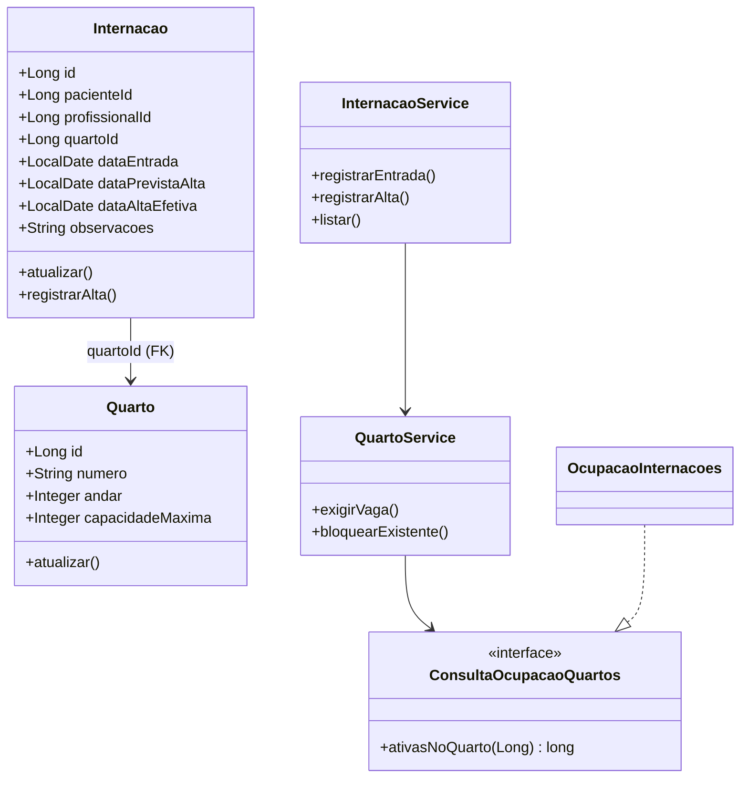

# Sprint 2 — entrega de Luiz Gustavo Moura e Souza

## Escopo e requisitos

Implementados os módulos `quartos` e `internacoes` sobre a fundação Spring Boot já integrada na `main` (`0e82337`), sem alterar os módulos de atendimentos, pacientes ou profissionais. Os PDFs do professor exigem os recursos `/quartos` e `/internacoes`, as informações mínimas, a capacidade de quartos, a disponibilidade e o histórico por paciente. Não especificam os verbos HTTP, os formatos JSON, os tipos de quarto nem todas as transições das internações.

As decisões de contrato abaixo seguem `docs/sprint-2/fundacao.md` e o padrão da API de atendimentos. A API não integra as telas estáticas de `frontend/` nesta entrega.

## API de quartos

| Método e recurso | Operação |
| --- | --- |
| `POST /quartos` | Cadastrar (`201`, `Location: /quartos/{id}`) |
| `GET /quartos` | Listar (`200`) |
| `GET /quartos/{id}` | Consultar (`200` ou `404`) |
| `PUT /quartos/{id}` | Atualizar número, andar e capacidade (`200`) |

Exemplo de cadastro:

```http
POST /quartos
Content-Type: application/json

{"numero":"101-A","andar":1,"capacidadeMaxima":2}
```

Resposta (`201 Created`, com `Location: /quartos/1`, ID ilustrativo):

```json
{
  "id": 1,
  "numero": "101-A",
  "andar": 1,
  "capacidadeMaxima": 2,
  "situacao": "DISPONIVEL",
  "ocupacaoAtual": 0,
  "vagasDisponiveis": 2
}
```

**Regras e decisões técnicas:**

- IDs `Long` positivos, gerados no banco. O número é texto de até 32 caracteres; espaços externos são removidos e letras são colocadas em maiúsculas. O número normalizado é único em todos os andares, respaldado por restrição `UNIQUE` no banco.
- O andar é um inteiro, inclusive zero ou negativo para pavimentos térreos/subsolos; o enunciado não determina limites. A capacidade deve ser maior que zero, inclusive por restrição `CHECK`.
- A situação é `DISPONIVEL` se não houver internações ativas e `OCUPADO` se houver pelo menos uma. **Ocupado não significa lotado**: `ocupacaoAtual` é a contagem das internações sem alta efetiva e `vagasDisponiveis = capacidadeMaxima - ocupacaoAtual`. Situação, ocupação e vagas **não são colunas independentes**.
- Uma atualização não pode baixar a capacidade abaixo do total de internações ativas. Alterar o número para outro já cadastrado retorna conflito. Não há exclusão de quartos referenciados.

## API de internações

| Método e recurso | Operação |
| --- | --- |
| `POST /internacoes` | Registrar entrada (`201`, `Location: /internacoes/{id}`) |
| `GET /internacoes` | Listar todas (`200`) |
| `GET /internacoes/{id}` | Consultar por ID (`200` ou `404`) |
| `GET /internacoes?pacienteId={id}` | Listar histórico por paciente (`200` ou `404`) |
| `GET /internacoes/paciente/{id}` | Rota específica do histórico por paciente (`200` ou `404`) |
| `PUT /internacoes/{id}` | Atualizar profissional, previsão de alta e observações de internação ativa (`200`) |
| `PATCH /internacoes/{id}/alta` | Registrar alta efetiva (`200`) |

Entrada (IDs ilustrativos de recursos já existentes):

```http
POST /internacoes
Content-Type: application/json

{"pacienteId":1,"profissionalId":10,"quartoId":1,"dataEntrada":"2026-11-20","dataPrevistaAlta":"2026-11-23","observacoes":"Acompanhamento"}
```

Resposta (`201 Created`):

```json
{
  "id": 1,
  "pacienteId": 1,
  "profissionalId": 10,
  "quartoId": 1,
  "dataEntrada": "2026-11-20",
  "dataPrevistaAlta": "2026-11-23",
  "dataAltaEfetiva": null,
  "observacoes": "Acompanhamento",
  "situacao": "ATIVA"
}
```

Atualização permitida:

```http
PUT /internacoes/1
Content-Type: application/json

{"profissionalId":11,"dataPrevistaAlta":"2026-11-25","observacoes":"Acompanhamento revisado"}
```

Alta efetiva:

```http
PATCH /internacoes/1/alta
Content-Type: application/json

{"dataAltaEfetiva":"2026-11-24"}
```

O retorno da alta mantém os vínculos e observações, informa `dataAltaEfetiva: "2026-11-24"` e `situacao: "ENCERRADA"`. A mesma internação permanece disponível em `GET /internacoes/1` e no histórico do paciente; a vaga torna-se disponível sem apagar dados.

**Ciclo mínimo adotado:**

1. O registro de entrada cria internação `ATIVA` (`dataAltaEfetiva == null`), após validar paciente, profissional, quarto e vaga.
2. Enquanto ativa, somente profissional responsável, previsão de alta e observações podem ser atualizados. Não se alteram paciente, quarto ou data original de entrada; transferência, reabertura e cancelamento não foram definidos pelo grupo.
3. A alta com data efetiva igual ou posterior à entrada encerra definitivamente a internação. Alta repetida e atualização posterior são conflitos (`409`). A previsão de alta pode ser nula; quando informada, não pode anteceder a entrada. A alta real pode diferir da previsão e **somente a alta real libera vaga**.
4. O histórico é consultado na mesma tabela de internações, filtrado pelo `pacienteId`, abrangendo registros ativos e encerrados, sem cópias de prontuário. Não existe endpoint de exclusão de registros históricos.

Datas usam `YYYY-MM-DD` (`LocalDate`), no contexto local do hospital `America/Sao_Paulo`, sem conversão implícita. O sistema não impõe regras de internação simultânea por paciente porque os PDFs e os contratos não definem tal proibição.

## Integridade, transações e concorrência

- H2 relacional em arquivo na execução normal; Flyway `V300__quartos.sql` e `V301__internacoes.sql`, no intervalo reservado à frente de Luiz. Hibernate usa `ddl-auto=validate`. Há chave estrangeira da internação para o quarto, índices de busca e restrições para capacidade e datas.
- `QuartoRepository.bloquear(id)` usa `PESSIMISTIC_WRITE` (equivalente a `SELECT ... FOR UPDATE` sobre a linha do quarto). **Entrada, alta e alteração de capacidade disputam o mesmo bloqueio**, sempre dentro de transação `@Transactional` de serviço.
- Na entrada, depois de obter o bloqueio, a ocupação ativa é recontada no banco. Só então se insere a internação. Duas transações não podem confirmar duas ocupações da última vaga. Redução da capacidade conta as mesmas internações sob o mesmo bloqueio. Para alta, consulta-se primeiro apenas o ID do quarto, bloqueia-se sua linha e só então se lê e modifica a internação, evitando repetir alta com estado carregado antes do bloqueio.
- A alta e a alteração da ocupação são uma única operação transacional: a contagem passa a desconsiderar a internação com `dataAltaEfetiva` preenchida, sem atualizar contador separado. Rollback preserva o estado anterior em caso de erro. `@Version` também protege atualizações das entidades contra gravações concorrentes incompatíveis.
- Os testes concorrentes usam barreira `CountDownLatch` com duas requisições de serviço iniciadas em paralelo, verificando o estado final persistido; não dependem de pausas arbitrárias. Cobrem última vaga, disputa entre redução e entrada, e alta simultânea a entrada.

## Contratos de integração

- Usa `Cadastros` (`compartilhado.contratos`) para `ConsultaPacientes.buscarPorId` e `ConsultaProfissionais.buscarPorId`. Não acessa diretamente repositories de cadastros nem cria cópias em produção. Sem a integração de Mateus, entradas e histórico com filtro por paciente retornam `503 MODULO_INDISPONIVEL`. IDs inexistentes com o módulo presente retornam `404 NAO_ENCONTRADO`.
- Quarto fornece `QuartoService.exigirVaga` e `bloquearExistente`; sua ocupação é fornecida pelo contrato local `ConsultaOcupacaoQuartos`, implementado em `internacoes.service.OcupacaoInternacoes` com `InternacaoRepository`. Não há acesso direto ao repository de outro módulo a partir dos services.
- Erros usam o `TratadorErros` compartilhado: `400 ENTRADA_INVALIDA` (formato ou validação), `404 NAO_ENCONTRADO`, `409 REGRA_NEGOCIO` ou `CONFLITO_DADOS`, e `503 MODULO_INDISPONIVEL`. Exemplo de quarto lotado:

```json
{"codigo":"REGRA_NEGOCIO","mensagem":"Quarto sem vagas disponiveis.","campos":[]}
```

## Trecho de diagrama para consolidação

O diagrama consolidado do grupo não foi sobrescrito. Este trecho deve ser incorporado por Warlley na integração:



## Como executar e testar

É necessário JDK 25. A partir de `backend/`:

```bash
./mvnw verify
./mvnw spring-boot:run
```

No PowerShell, use `./mvnw.cmd verify` e `./mvnw.cmd spring-boot:run`. API em `http://localhost:8080`. Testes usam H2 em memória com contextos isolados; o teste de persistência cria banco temporário em `backend/target/` para verificar reinícios.

Testes incluídos:

- `QuartoApiTest`: cadastro, consulta, listagem, atualização, normalização, unicidade, validação e erros.
- `InternacaoApiTest`: vínculos existentes/inexistentes, entrada, ocupação parcial/lotação, datas, alterações permitidas, alta, rejeição de alta repetida, histórico separado por paciente e redução indevida de capacidade.
- `ConcorrenciaInternacoesTest`: disputas pela última vaga, entre alteração da capacidade e entrada, e entre alta e entrada.
- `PersistenciaInternacoesTest`: integridade de quarto, internação, alta e histórico ao reiniciar a aplicação com o mesmo arquivo H2.
- `DependenciasInternacoesTest`: comportamento `503` sem cadastros integrados.

## Pendências e decisões de grupo

1. **Tipos de quartos (pendente):** o último item do PDF da Sprint 2 os cita, mas não oferece uma lista de tipos, critérios ou regras. `docs/sprint-2/fundacao.md` também registra a pendência. Não foram inventadas categorias UTI, enfermaria ou apartamento; confirmar com professor/grupo e incluir numa alteração combinada. **Esse subrequisito ainda não está concluído.**
2. **Integração de cadastros:** a branch `mateus` tem implementação própria, mas não foi misturada à `main` nesta frente. Validar os contratos com a versão integrada no PR final.
3. **Fluxo de internação:** somente `ATIVA -> ENCERRADA` pela alta efetiva, conforme o ciclo mínimo proposto na fundação. Confirmar com o grupo caso sejam solicitadas transferências, reabertura ou outros estados.
4. **Prontuário completo:** a integração do histórico conjunto com consultas pertence à frente de integração, que pode consumir os registros oferecidos por `/internacoes/paciente/{id}`.
5. **Operação real:** H2 é escolha acadêmica da fundação, não um plano de produção hospitalar; autenticação, privacidade, auditoria e operação clínica real exigem desenho específico em outra etapa.
