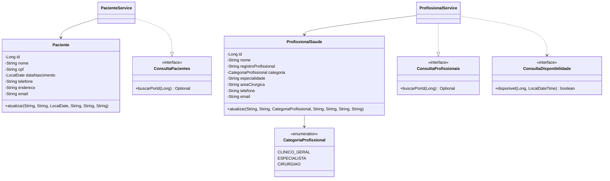

# Entrega de Mateus Andrade Motta · Sprint 2

Branch `mateus`. A entrega implementa pacientes e profissionais no backend
compartilhado do Sistema Hospitalar.

## Escopo e decisões

- O enunciado geral define os dados mínimos, Spring Boot, persistência e
  arquitetura em camadas. O enunciado da Sprint 2 inclui os dois endpoints,
  as três categorias profissionais e a representação da atuação cirúrgica.
- A [fundação integrada](sprint-2/fundacao.md) fornece os IDs `Long` positivos,
  a estrutura de erros, os contratos entre módulos e o H2 em arquivo. Os
  verbos de cadastro seguem as [convenções do projeto](sprint-2/contratos.md).
- As migrações Flyway `V200__pacientes.sql` e `V201__profissionais.sql`
  criam as tabelas da frente. O H2 mantém as restrições de unicidade durante
  escritas concorrentes. O Hibernate valida o esquema e usa versionamento
  interno para detectar atualizações concorrentes sobre a mesma linha.
- O `PUT` substitui os dados editáveis e aplica as mesmas validações do
  cadastro. O ID é gerado pelo banco e permanece o mesmo. Os cadastros
  referenciados por outros módulos são preservados, sem rota de exclusão.

## Como executar e testar

Com JDK 25, na raiz do repositório, pelo PowerShell:

```powershell
cd backend
.\mvnw.cmd verify
.\mvnw.cmd spring-boot:run
```

A API inicia em `http://localhost:8080` com o banco em `backend/data/hospital.mv.db`.
No Linux e macOS, use `./mvnw`. Para testar só a entrega:

```powershell
.\mvnw.cmd '-Dtest=PacienteApiTest,ProfissionalSaudeTest,ProfissionalApiTest,IntegracaoCadastrosAgendaTest,PersistenciaCadastrosTest' test
```

Os testes de API usam H2 isolado em memória. O teste de persistência fecha o
contexto, abre novamente o mesmo arquivo H2 temporário e consulta os dados
pela API interna e pela ponte `Cadastros`. O teste de agenda usa os serviços
reais, inclusive a reserva e sua liberação ao cancelar a consulta.

O comando `clean verify` executou 40 testes sem falhas, incluindo os 17
da frente de cadastros. Os testes legados de atendimentos selecionam os
cadastros simulados somente nos seus contextos de teste. O teste da fundação
isola o cenário de dependência ausente e continua verificando a resposta
`503 MODULO_INDISPONIVEL`.

## API de cadastro

| Método | Caminho | Sucesso |
| --- | --- | --- |
| POST | `/pacientes`, `/profissionais` | `201`, corpo do cadastro e cabeçalho `Location` |
| GET | `/pacientes`, `/profissionais` | `200`, lista por ID crescente |
| GET | `/pacientes/{id}`, `/profissionais/{id}` | `200`, cadastro encontrado |
| PUT | `/pacientes/{id}`, `/profissionais/{id}` | `200`, cadastro atualizado |

### Pacientes

```http
POST /pacientes
Content-Type: application/json

{
  "nome": "Ana Exemplo",
  "cpf": "123.456.789-09",
  "dataNascimento": "1995-02-15",
  "telefone": "(31) 99999-0000",
  "endereco": "Rua Exemplo, 12",
  "email": "ana@example.org"
}
```

Exemplo de resposta com `201 Created` e `Location: /pacientes/1`:

```json
{
  "id": 1,
  "nome": "Ana Exemplo",
  "cpf": "12345678909",
  "dataNascimento": "1995-02-15",
  "telefone": "(31) 99999-0000",
  "endereco": "Rua Exemplo, 12",
  "email": "ana@example.org"
}
```

Os seis campos são obrigatórios. O CPF aceita 11 dígitos com ou sem a máscara
`000.000.000-00` e é armazenado só com dígitos, preservando zeros à esquerda.
A unicidade vale sobre essa forma. A validação é de formato. A data segue
`AAAA-MM-DD` e pode ser hoje ou uma data anterior. Nome e endereço têm
limites de 120 e 255 caracteres, respectivamente.

### Profissionais

```http
POST /profissionais
Content-Type: application/json

{
  "nome": "Profissional Exemplo",
  "registroProfissional": " crm-mg 100 ",
  "categoria": "CIRURGIAO",
  "especialidade": "Cardiologia",
  "areaCirurgica": "Cirurgia cardiovascular",
  "telefone": "(31) 99999-0000",
  "email": "equipe@example.org"
}
```

Exemplo de resposta com `201 Created` e `Location: /profissionais/1`:

```json
{
  "id": 1,
  "nome": "Profissional Exemplo",
  "registroProfissional": "CRM-MG 100",
  "categoria": "CIRURGIAO",
  "especialidade": "Cardiologia",
  "areaCirurgica": "Cirurgia cardiovascular",
  "telefone": "(31) 99999-0000",
  "email": "equipe@example.org"
}
```

| Categoria | Representação no cadastro e uso em atendimentos |
| --- | --- |
| `CLINICO_GERAL` | Identifica o profissional apto a consultas de rotina. |
| `ESPECIALISTA` | Informa a especialidade usada para verificar a compatibilidade com a consulta especializada. |
| `CIRURGIAO` | Exige `areaCirurgica` para registrar o campo de atuação e identifica o profissional apto a cirurgias. |

Nome, registro, categoria, especialidade, telefone e e-mail são obrigatórios.
Envie a categoria pelo nome da tabela, como texto no JSON.
O registro profissional é único após remover espaços externos e converter
para maiúsculas. Pontuação e espaços internos fazem parte do registro. O limite
do registro é 60 caracteres. Nome, especialidade e área cirúrgica têm limite de
120 caracteres. A área cirúrgica fica ausente ou nula nas demais categorias.
A escolha de um único modelo com enum reaproveita os dados comuns. As regras
de execução de cada modalidade ficam em atendimentos.

Nos dois cadastros, o telefone tem até 30 caracteres, ao menos um dígito e
aceita espaços, parênteses, hífen, ponto e `+` inicial. O e-mail tem formato
validado e limite de 254 caracteres.

### Filtro e erros

- `GET /profissionais?especialidade=Cardiologia` seleciona cadastros com
  especialidade igual, ignorando maiúsculas, minúsculas e espaços externos.
  O filtro vazio é equivalente à listagem geral.
- `GET /profissionais?especialidade=Cardiologia&inicio=2026-11-20T10:00:00`
  retorna apenas os profissionais sem reserva naquele início, no horário local
  do hospital. Com `inicio` sozinho, o mesmo critério se aplica a todas as
  especialidades. O resultado é informativo. O registro do atendimento
  revalida a reserva.
- Corpo ou parâmetros inválidos retornam `400 ENTRADA_INVALIDA`.
  ID inexistente retorna `404 NAO_ENCONTRADO`. Duplicidades retornam
  `409 CONFLITO_DADOS`. Categoria incompatível com a área cirúrgica retorna
  `409 REGRA_NEGOCIO`.

Exemplo de resposta para ID inexistente:

```json
{"codigo":"NAO_ENCONTRADO","mensagem":"Paciente não encontrado.","campos":[]}
```

## Contratos fornecidos

- `ConsultaPacientes.buscarPorId(Long)` fornece `Optional<PacienteResumo>`,
  com ID e nome.
- `ConsultaProfissionais.buscarPorId(Long)` fornece
  `Optional<ProfissionalResumo>`, com ID, nome, categoria e especialidade.
- Cada serviço registra um bean para sua interface e devolve `Optional.empty()`
  para um ID ausente. Atendimentos e internações podem usar as interfaces ou
  a ponte compartilhada `Cadastros`.
- O filtro por horário consome `ConsultaDisponibilidade.disponivel(Long, LocalDateTime)`,
  implementado em atendimentos. A regra é a mesma da agenda integrada: igualdade
  do início previsto, sem cálculo de sobreposição de duração.

## Trecho para o diagrama consolidado



## Pendências de integração

- Consolidar este trecho no diagrama geral da Sprint 2 e validar as referências
  de internações quando a frente correspondente for integrada.
- Categoria e especialidade podem ser atualizadas pelo cadastro. O módulo de atendimentos
  revalida a compatibilidade ao iniciar um atendimento. Reservas existentes
  continuam sob controle da agenda.
- As telas da Sprint 1 continuam como protótipo. Esta entrega expõe a API.
