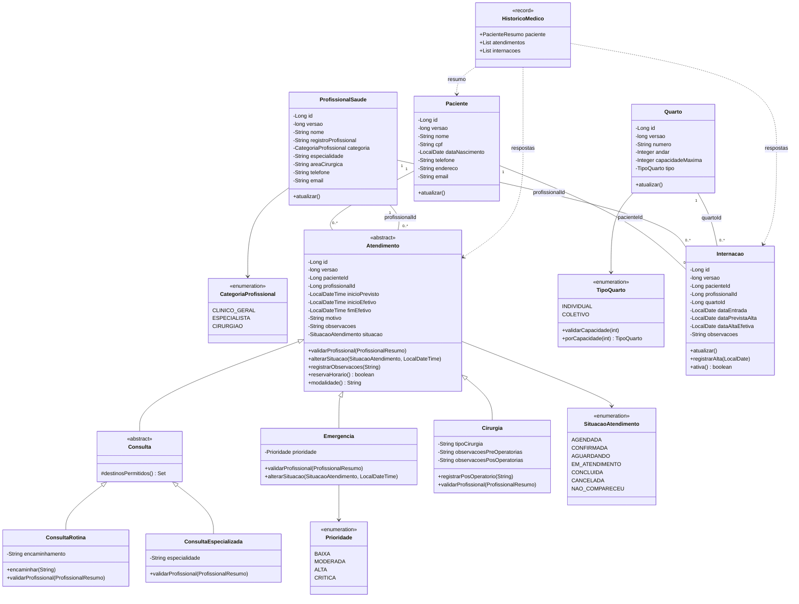

# Diagrama de classes consolidado — Sprint 2

Modelo do código integrado. As associações por ID representam vínculos de domínio;
entre módulos, a implementação usa contratos de consulta e não associações JPA.
O [modelo da Sprint 1](sprint-1/diagrama-classes.svg) está preservado para comparação.

## Camadas e colaboração

Cada módulo contém Controller, Service, Repository, Model e DTOs. Controllers
validam a entrada; services coordenam transações e contratos; modelos protegem
comportamentos; repositories acessam o banco. Classes de infraestrutura foram
separadas do diagrama de domínio para facilitar a leitura.

- `PacienteService` implementa `ConsultaPacientes`; `ProfissionalService` implementa
  `ConsultaProfissionais`. A ponte `Cadastros` valida referências entre módulos.
- `AtendimentoService` implementa `ConsultaDisponibilidade`; profissionais a usam
  para filtrar disponibilidade, sem criar outra agenda.
- `AgendaRepository` mantém a reserva única por profissional e início e usa o
  bloqueio transacional de `controle_agenda`. Herança dos atendimentos usa JPA
  `SINGLE_TABLE` com discriminador de modalidade.
- `QuartoService` usa `ConsultaOcupacaoQuartos`, implementada por
  `OcupacaoInternacoes`. Entrada, alta e alteração de capacidade bloqueiam o mesmo
  quarto. A multiplicidade inclui todas as internações históricas; a capacidade
  limita somente as ativas.
- `HistoricoService` agrega os DTOs dos services de atendimentos e internações.
  `HistoricoMedico` é uma visão calculada, sem tabela duplicada de prontuário.
- `SituacaoQuarto` (DISPONIVEL/OCUPADO) e `SituacaoInternacao` (ATIVA/ENCERRADA)
  são calculadas nas respostas. Situação ocupada não significa ausência de vaga.

A tabela de transições e as decisões sobre tipos estão na
[entrega consolidada](EntregaSprint2.md).
