# Diagrama implementado: frente de Warlley

Complementa o modelo inicial da Sprint 1. Cadastros e internações devem ser
consolidados com os diagramas dos respectivos autores após integração.

```mermaid
classDiagram
    class Atendimento {
        <<abstract>>
        -Long id
        -long versao
        -Long pacienteId
        -Long profissionalId
        -LocalDateTime inicioPrevisto
        -LocalDateTime inicioEfetivo
        -LocalDateTime fimEfetivo
        -String motivo
        -String observacoes
        -SituacaoAtendimento situacao
        +validarProfissional(ProfissionalResumo)
        +alterarSituacao(SituacaoAtendimento, LocalDateTime)
        +registrarObservacoes(String)
        +reservaHorario() boolean
        +modalidade() String
    }
    class Consulta {
        <<abstract>>
        #destinosPermitidos() Set
    }
    class ConsultaRotina {
        -String encaminhamento
        +encaminhar(String)
        +validarProfissional(ProfissionalResumo)
    }
    class ConsultaEspecializada {
        -String especialidade
        +validarProfissional(ProfissionalResumo)
    }
    class Emergencia {
        -Prioridade prioridade
        +validarProfissional(ProfissionalResumo)
        +alterarSituacao(SituacaoAtendimento, LocalDateTime)
    }
    class Cirurgia {
        -String tipoCirurgia
        -String observacoesPreOperatorias
        -String observacoesPosOperatorias
        +registrarPosOperatorio(String)
        +validarProfissional(ProfissionalResumo)
    }
    class SituacaoAtendimento {
        <<enumeration>>
        AGENDADA
        CONFIRMADA
        AGUARDANDO
        EM_ATENDIMENTO
        CONCLUIDA
        CANCELADA
        NAO_COMPARECEU
    }
    class Prioridade {
        <<enumeration>>
        BAIXA
        MODERADA
        ALTA
        CRITICA
    }
    class AtendimentoService {
        +criarConsulta(NovaConsulta) AtendimentoResposta
        +criarEmergencia(NovaEmergencia) AtendimentoResposta
        +criarCirurgia(NovaCirurgia) AtendimentoResposta
        +transicionar(String, Long, Transicao) AtendimentoResposta
        +registrar(String, Long, RegistroClinico) AtendimentoResposta
        +disponivel(Long, LocalDateTime) boolean
    }
    class AtendimentoRepository {
        <<interface>>
    }
    class AgendaRepository {
        +bloquear()
        +ocupado(Long, LocalDateTime) boolean
        +reservar(Long, Long, LocalDateTime)
        +liberar(Long)
    }
    class Cadastros {
        +paciente(Long) PacienteResumo
        +profissional(Long) ProfissionalResumo
    }
    class ConsultaPacientes {
        <<interface>>
        +buscarPorId(Long) Optional
    }
    class ConsultaProfissionais {
        <<interface>>
        +buscarPorId(Long) Optional
    }
    class ConsultaDisponibilidade {
        <<interface>>
        +disponivel(Long, LocalDateTime) boolean
    }
    Atendimento <|-- Consulta
    Consulta <|-- ConsultaRotina
    Consulta <|-- ConsultaEspecializada
    Atendimento <|-- Emergencia
    Atendimento <|-- Cirurgia
    Atendimento --> SituacaoAtendimento
    Emergencia --> Prioridade
    AtendimentoService ..|> ConsultaDisponibilidade
    AtendimentoService --> AtendimentoRepository
    AtendimentoService --> AgendaRepository
    AtendimentoService --> Cadastros
    Cadastros --> ConsultaPacientes
    Cadastros --> ConsultaProfissionais
```

Persistência: herança JPA `SINGLE_TABLE` em `atendimento`, discriminada por
modalidade. A reserva fica em `reserva_agenda`, com FK para atendimento e unicidade
por profissional e início. `controle_agenda` contém a linha de bloqueio transacional.
Os vínculos com pacientes e profissionais usam IDs e contratos públicos.
